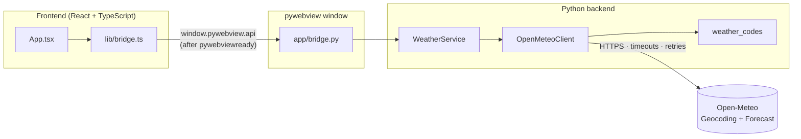

<div align="center">

# 🌤️ AtmosGlass Weather

**A premium glassmorphism desktop weather app — Python + pywebview backend, React + TypeScript frontend, live data from Open-Meteo.**


[Features](#-features) · [Screenshots](#-screenshots) · [Installation](#-installation--usage) · [Architecture](#-architecture) · [Testing](#-testing) · [Contributing](#-contributing)

</div>

---

## 📖 Introduction

**AtmosGlass Weather** is a desktop weather application that combines a polished, translucent "glass" interface with a clean Python backend. You can search any city in the world, pick the exact match from a list of suggestions, and see live current conditions, a 24-hour forecast and a 7-day outlook, all in a single window.

### Purpose

This project was built to demonstrate how to:

- Run a modern **React + TypeScript + Vite** UI inside a native desktop window using **pywebview**, without Electron.
- Keep **all network access in Python** and talk to the UI through a small, typed, validated JavaScript bridge.
- Build a **resilient API client** (timeouts, bounded retries, response validation, graceful degradation) that is fully testable **offline**.

> **Design rule:** the React frontend never calls a weather API directly. It can only call three Python methods exposed through the bridge.

---

## 📸 Screenshots

> The images below live in [`docs/screenshots/`](docs/screenshots). Replace them with your own captures (see [Adding screenshots](#adding-screenshots)).

<div align="center">

| Dashboard (day) | City search & suggestions |
|:---:|:---:|
|  |  |

| Hourly & 7-day forecast | Error state with retry |
|:---:|:---:|
|  |  |

</div>

<details>
<summary><strong>Adding screenshots</strong></summary>

1. Run the app (`python main.py`).
2. Capture the window (Windows: `Win + Shift + S`).
3. Save the files as `dashboard.png`, `search.png`, `forecast.png` and `error-state.png` inside `docs/screenshots/`.

</details>

---

## ✨ Features

### 🌦️ Weather information

| Area | What you get |
|---|---|
| **Current conditions** | Temperature, weather condition, feels-like temperature, humidity, wind speed and direction |
| **Additional metrics** | Precipitation, pressure, visibility, UV index (with risk label), cloud cover, wind gusts |
| **Hourly forecast** | The next 24 hours, starting from the current hour **in the selected city's own timezone** |
| **7-day forecast** | Condition, rain chance, and minimum / maximum temperature with a range bar |
| **Local time** | City-local time and IANA timezone (for example `Asia/Kolkata`) |

### 🪟 Interface

- Dark, translucent **glassmorphism** design with blur, layered cards and soft borders
- **Weather-themed accents:** the colour palette shifts for clear, cloudy, fog, rain, snow and thunderstorm scenes, with a darker tone at night
- Light animations (card entrance, hover lift, shimmer skeleton loader, spinner)
- **Responsive layout** from wide desktop windows down to the 480 px minimum window width
- **Accessible:** semantic landmarks, labelled inputs, live status regions, visible keyboard focus, and `prefers-reduced-motion` support

### 🔎 Search & reliability

- Search for **arbitrary cities** with debounced live suggestions
- **Ambiguity-safe:** similar names (for example several "Jaipur" results) show region, country and coordinates, and **nothing is selected automatically** except the initial demo city
- Loading skeletons, "no results" message, error panels and **retry** controls
- Manual **Refresh** button (disabled while a request is running); stale responses are ignored
- If a refresh fails, the **last loaded data stays visible** with a warning banner

### 🛡️ Backend quality

- Explicit connect/read **timeouts** (5 s / 10 s) and **bounded retries** with exponential backoff
- Retries only for transient failures (timeouts, connection errors, HTTP 500/502/503/504); **never** for HTTP 429 or other 4xx
- **Graceful degradation:** if the API rejects an optional variable, it is dropped and reported in `skipped_variables`
- Strict **input validation** and **response validation**; missing optional values become `null`, never a crash
- Unknown WMO weather codes fall back to a neutral "Conditions unavailable" state

---

## 🧰 Technologies

| Layer | Technology |
|---|---|
| Desktop shell | [pywebview](https://pywebview.flowrl.com/) (built-in local HTTP server, no `file://`) |
| Backend | Python 3.11+ (developed on 3.12), [`requests`](https://requests.readthedocs.io/) |
| Frontend | React, TypeScript (strict), Vite |
| Styling | Hand-written CSS with custom properties (no UI framework, no CDN) |
| Data | [Open-Meteo](https://open-meteo.com/) Forecast and Geocoding APIs |
| Testing | pytest with a fake HTTP session (no internet required) |

---

## 🚀 Installation & Usage

### Prerequisites

- **Python 3.11 or newer**
- **Node.js LTS** (with npm)
- **Windows:** the [Microsoft Edge WebView2 Runtime](https://developer.microsoft.com/microsoft-edge/webview2/) (preinstalled on current Windows 10/11)
- An internet connection (for live weather data)

> The app has been developed and tested on **Windows**. macOS and Linux are supported by pywebview but have not been verified for this project; Linux additionally needs a GTK or Qt backend (see the [pywebview installation guide](https://pywebview.flowrl.com/guide/installation.html)).

### 1. Clone the repository

```bash
git clone https://github.com/<your-username>/atmosglass-weather.git
cd atmosglass-weather
```

### 2. Set up the Python environment

**Windows (PowerShell)**

```powershell
python -m venv .venv
.\.venv\Scripts\python.exe -m pip install -r requirements-dev.txt
```

**macOS / Linux**

```bash
python3 -m venv .venv
.venv/bin/python -m pip install -r requirements-dev.txt
```

### 3. Build the frontend

```powershell
cd frontend
npm install
npm run build
cd ..
```

This produces `frontend/dist/`, which the desktop window loads.

### 4. Run the app

**Windows (PowerShell)**

```powershell
.\.venv\Scripts\python.exe main.py
```

**macOS / Linux**

```bash
.venv/bin/python main.py
```

The window opens with **Jaipur** as the demo city (found through geocoding — no coordinates are hardcoded). Use the search box to look up any other city.

### Useful options

| Goal | Command |
|---|---|
| Open developer tools | `$env:ATMOSGLASS_DEBUG="1"` (PowerShell) or `ATMOSGLASS_DEBUG=1` (bash), then run `main.py` |
| Rebuild after changing the UI | `cd frontend && npm run build` |
| Run the UI alone in a browser | `cd frontend && npm run dev` (weather calls will show a "pywebview not detected" error because Python is not running) |

### Troubleshooting

<details>
<summary><strong>PowerShell: "npm.ps1 cannot be loaded because running scripts is disabled"</strong></summary>

Use `npm.cmd` instead of `npm` (for example `npm.cmd run build`), or allow local scripts for your user:

```powershell
Set-ExecutionPolicy -Scope CurrentUser -ExecutionPolicy RemoteSigned
```

</details>

<details>
<summary><strong>The window shows "Frontend build not found"</strong></summary>

Run `npm install` and `npm run build` inside `frontend/`, then start the app again.

</details>

<details>
<summary><strong>The window is blank or does not open (Windows)</strong></summary>

Install or repair the Microsoft Edge WebView2 Runtime, then launch with `ATMOSGLASS_DEBUG=1` to inspect the console.

</details>

<details>
<summary><strong>"Weather unavailable" / network errors</strong></summary>

Check your internet connection and press **Try again**. If you see a rate-limit message, wait a minute before retrying.

</details>

---

## 🗂️ Project structure

```text
atmosglass-weather/
├── main.py                        # Desktop launcher: creates the pywebview window
├── requirements.txt               # Runtime dependencies
├── requirements-dev.txt           # Runtime + test dependencies
│
├── app/                           # Python backend
│   ├── bridge.py                  # JavaScript API exposed to React (validated, JSON-safe envelopes)
│   ├── services/
│   │   └── weather_service.py     # Orchestration: validates a selected location, requests its forecast
│   ├── clients/
│   │   └── open_meteo_client.py   # The only module that knows provider URLs, params, retries, normalization
│   └── utils/
│       └── weather_codes.py       # WMO weather code → label, icon id, scene id
│
├── frontend/                      # React + TypeScript + Vite UI
│   ├── vite.config.ts             # base: "./" so built assets load from relative paths
│   ├── index.html                 # Vite source entry
│   ├── src/
│   │   ├── main.tsx               # React entry point
│   │   ├── App.tsx                # Dashboard: search, current weather, hourly, daily, states
│   │   ├── pywebview.d.ts         # TypeScript declarations for window.pywebview
│   │   ├── lib/bridge.ts          # Typed bridge client + pywebviewready handling
│   │   └── styles/
│   │       ├── app.css            # Global base styles
│   │       └── dashboard.css      # Dashboard glassmorphism styles (all classes prefixed "ag-")
│   └── dist/                      # Generated production build (not committed)
│
├── tests/                         # Offline pytest suite
│   ├── test_open_meteo_client.py  # Mapping, normalization, validation, retries, error codes, service
│   └── test_bridge.py             # Bridge envelopes, input sanitizing, error safety
│
└── docs/
    └── screenshots/               # README images
```

| Folder | Responsibility |
|---|---|
| `app/` | All business logic and network access. Nothing here imports the UI. |
| `frontend/` | Presentation only. Talks to Python exclusively through `lib/bridge.ts`. |
| `tests/` | Fast, deterministic tests that never touch the internet. |

---

## 🏗️ Architecture



**Request flow**

1. React waits for the `pywebviewready` event, then calls `search_locations(query)`.
2. `bridge.py` validates the input and calls `WeatherService`.
3. `OpenMeteoClient` queries the Geocoding API and returns normalized locations.
4. The user picks a place; React calls `get_weather(location)` with that location's coordinates.
5. The client requests current, hourly and daily data in **one** forecast call, validates it and returns a JSON-safe payload.
6. The bridge wraps everything in a standard envelope; React renders data or a friendly error.

**Security & safety**

- Only **three** methods are exposed to JavaScript; private helpers use a leading underscore.
- Bridge inputs are validated and reduced to a small allow-list of fields.
- Provider hostnames are fixed; no arbitrary URL fetching, shell access or `eval` is exposed.
- All dynamic text is rendered through React (escaped by default); no `innerHTML`.
- Exceptions never reach the UI: they are converted to error codes with friendly messages, and details go to the log.

---

## 🌐 API & data source

Weather and geocoding data come from **[Open-Meteo](https://open-meteo.com/)**:

| Purpose | Endpoint |
|---|---|
| City search | `https://geocoding-api.open-meteo.com/v1/search` |
| Forecast | `https://api.open-meteo.com/v1/forecast` |

> ⚠️ **Usage terms:** Open-Meteo's free API is intended for **non-commercial** use and requires attribution (the app displays it in the footer). If you plan to distribute this app commercially, review Open-Meteo's current terms and consider a commercial plan.

### Bridge API (Python ⇄ React)

| Method | Input | Returns |
|---|---|---|
| `get_app_info()` | none | `{ name, version, message }` |
| `search_locations(query)` | string (2–100 chars) | envelope with a list of locations |
| `get_weather(location)` | `{ latitude, longitude, name, display_name }` | envelope with the normalized forecast |

**Standard envelope**

```jsonc
{
  "ok": true,                      // false on failure
  "data": {},                      // null on failure
  "meta": { "cached": false, "stale": false, "fetched_at": "ISO-8601 or null" },
  "error": null                    // { "code": "...", "message": "..." } on failure
}
```

**Error codes**

| Code | Meaning |
|---|---|
| `VALIDATION_ERROR` | Invalid city name or location |
| `TIMEOUT` | The provider took too long to respond |
| `NETWORK_ERROR` | Could not reach the provider |
| `RATE_LIMITED` | HTTP 429 from the provider (never retried) |
| `PROVIDER_ERROR` | The provider rejected the request or is unavailable |
| `INVALID_RESPONSE` | The provider returned unreadable or unexpected data |
| `UNKNOWN_ERROR` | Unexpected failure (details are logged, not shown) |

<details>
<summary><strong>Normalized forecast shape</strong> (structure only)</summary>

```jsonc
{
  "source": "open-meteo",
  "fetched_at": "ISO-8601 UTC",
  "location": { "name": "string|null", "latitude": 0, "longitude": 0, "elevation": 0 },
  "timezone": { "id": "IANA name", "abbreviation": "string", "utc_offset_seconds": 0 },
  "units": { "temperature": "°C", "wind_speed": "km/h", "pressure": "hPa", "visibility": "m", "...": "..." },
  "current": {
    "time": "local ISO time", "is_day": true,
    "temperature": 0, "apparent_temperature": 0, "humidity": 0, "wind_speed": 0, "wind_direction": 0,
    "precipitation": 0, "pressure": 0, "visibility": 0, "uv_index": 0, "cloud_cover": 0, "wind_gusts": 0,
    "weather": { "code": 0, "label": "string", "icon": "string", "scene": "string" }
  },
  "hourly": [ { "time": "local ISO time", "temperature": 0, "precipitation_probability": 0, "weather": {} } ],
  "daily":  [ { "date": "YYYY-MM-DD", "temperature_max": 0, "temperature_min": 0, "sunrise": "", "sunset": "",
               "moonrise": "", "moonset": "", "uv_index_max": 0, "precipitation_sum": 0, "weather": {} } ],
  "skipped_variables": []
}
```

Every numeric field is `number | null`. A value the API does not provide is `null`, and the UI shows "—".

</details>

---

## 🧪 Testing

The test suite is **fully offline**: a fake HTTP session replaces the network, so tests are fast and deterministic.

```powershell
# Windows
.\.venv\Scripts\python.exe -m pytest -q
```

```bash
# macOS / Linux
.venv/bin/python -m pytest -q
```

**What is covered (16 test cases)**

- WMO weather-code mapping, day/night icons and the unknown-code fallback
- Forecast normalization, missing optional data, midnight boundaries, JSON-serializability
- City search validation, empty results, malformed entries and normalization
- Retry policy: bounded retries on timeouts / connection errors / 5xx, **no** retry on 429 and 4xx
- Graceful dropping of unsupported optional variables (and failing loudly for core ones)
- Coordinate validation and dynamic coordinates passed from a selected location
- Bridge envelopes, input sanitizing, and guarantees that errors never raise into the UI

**Frontend type-check and build** (strict TypeScript):

```powershell
cd frontend
npm run build
```

---

## 🗺️ Roadmap

Planned improvements (not yet implemented):

- [ ] SQLite persistence: favourite cities and a weather cache with stale-data fallback
- [ ] Settings: temperature / wind units, theme and reduced-motion toggle
- [ ] Rotating log files in the OS user-data directory
- [ ] Windows packaging with PyInstaller
- [ ] Animated weather scenes (rain, snow ambience) and richer motion polish

---

## 🤝 Contributing

Contributions are welcome!

1. **Fork** the repository and create a branch: `git checkout -b feature/short-description`
2. **Set up** the project using the [installation steps](#-installation--usage).
3. **Make your change**, keeping the architecture rules:
   - All network access stays in Python (`app/clients`).
   - React talks to Python only through `frontend/src/lib/bridge.ts`.
   - New backend behaviour needs an offline test in `tests/`.
4. **Verify** before opening a pull request:
   ```powershell
   .\.venv\Scripts\python.exe -m pytest -q
   cd frontend; npm run build
   ```
5. **Commit** with a clear message (for example `feat: add favourites list`) and open a **pull request** describing what changed and why. Include a screenshot for UI changes.

Please open an issue first for large changes, and be respectful in discussions.

---

## 📄 License

Distributed under the **MIT License**. See the [`LICENSE`](LICENSE) file for details.

Weather data © [Open-Meteo.com](https://open-meteo.com/), licensed under [CC BY 4.0](https://creativecommons.org/licenses/by/4.0/).

---

## 🙏 Acknowledgements

- [Open-Meteo](https://open-meteo.com/) for the free weather and geocoding APIs
- [pywebview](https://pywebview.flowrl.com/) for the lightweight desktop shell
- [React](https://react.dev/) and [Vite](https://vite.dev/) for the frontend tooling

<div align="center">

**If you like this project, consider giving it a ⭐**

</div>